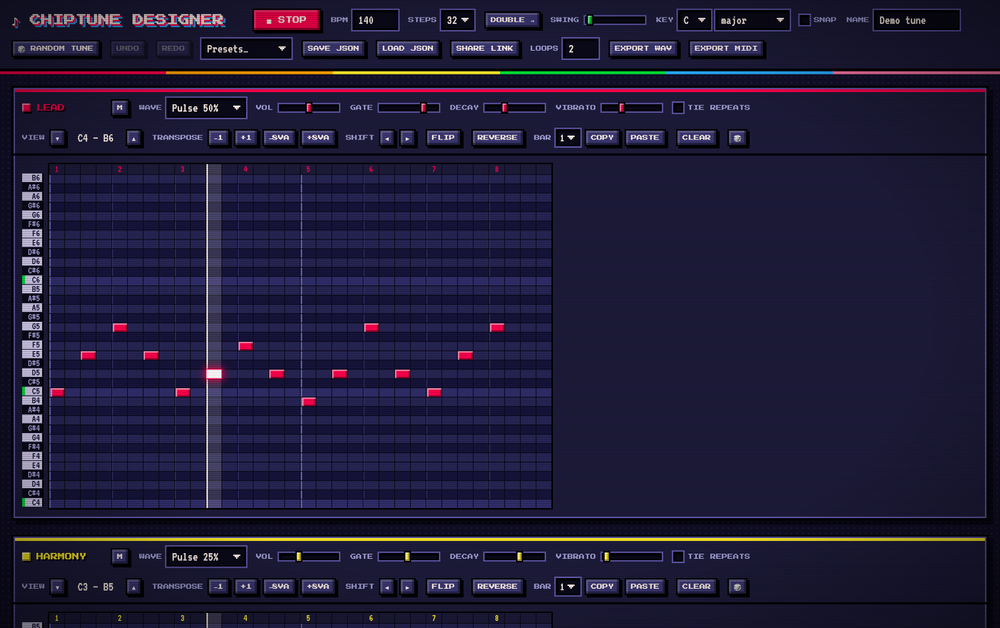

# Chiptune Designer

A tiny 8-bit music maker that runs entirely in the browser. Paint notes on a piano roll for three
synth voices plus a drum machine, or roll the dice to generate a whole tune.



## Getting started

There is nothing to install or build. Open `index.html` in a browser, or serve the folder:

```sh
python3 -m http.server
# then visit http://localhost:8000
```

Press <kbd>Space</kbd> to play or stop. Your pattern autosaves in the browser.

## Features

- **Three voices and drums.** Lead, harmony and bass each have their own waveform (12.5/25/50/75%
  pulse, triangle, sawtooth), volume, gate, decay, vibrato and an option to tie repeated notes into
  one long note. The noise drums (kick, snare, closed and open hat) use a NES-style noise generator.
- **Piano-roll editing.** Click or drag to paint. Right-drag erases. Hold <kbd>Shift</kbd> while
  dragging to keep the same pitch. Click a piano key to hear it. Rows that are in the chosen key are
  highlighted, and **Snap** stops you painting notes outside the key.
- **Composition tools.** For each voice: transpose, shift the pattern left or right, flip it upside
  down, reverse it, and copy/paste bars between voices. Undo/redo with
  <kbd>Ctrl/Cmd</kbd>+<kbd>Z</kbd>.
- **Random generator.** 🎲 **Random tune** writes chords, melody, bass and drums in a random key.
  The 🎲 on each part re-rolls just that part in the current key. Melodies come in lyrical, arpeggio,
  driving and bouncy styles, with question/answer phrases, lead-in notes and a high point.
- **Sharing and export.** Save or load a pattern as JSON, copy a share link that holds the whole
  pattern in its URL, or export WAV audio or a MIDI file (one track per voice plus a General MIDI
  drum track).
